<p align="center">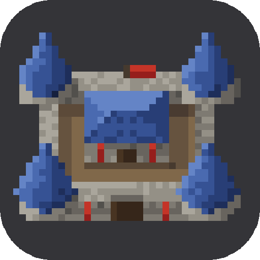</p>

# Codixel

Codixel is a Claude Code skill for making pixel art with AI: game sprites, characters, animations and effects like fire, smoke and beams. It covers how to describe what you want, the steps from a reference image to a finished animated sprite, and why you have to check every step.

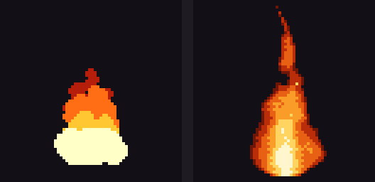

Left: without Codixel. Right: with Codixel.

## Steps

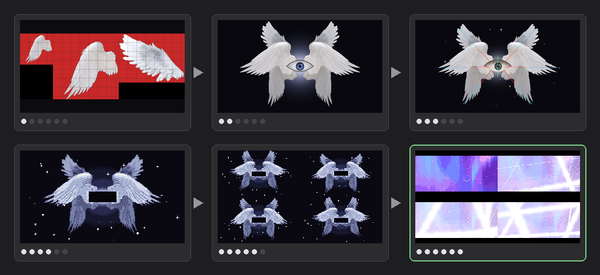

1. Find real images of what you want. Use your own, or ones whose license allows it.
2. Have the AI put it together in code from those images.
3. Ask for bones so the parts can move.
4. Ask for pixel art and say how it should look, for example "realistic".
5. Look at the animation frames one by one.
6. Put it in the scene and check it next to everything else.

Here the bones come before the pixels, because the god is put together from several images. With a single image, like Kinryu, turn it into pixels first and add the bones after.


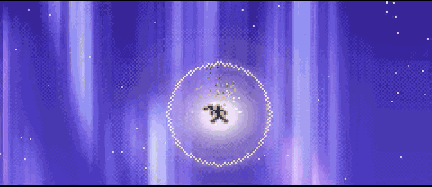

## What to do

- [Remember Claude Code is not a painter, it only writes code](#claude-code-is-not-a-painter)
- [Start from a real reference image](#example-kinryu)
- [Give a reference to compare with](#example-astral-prison)
- [Go step by step](#steps)
- [Ask for how it should look, like "realistic"](#example-ocean)
- [Build characters from only a few pixels](#example-mini-characters)
- [Use dither only where two colors meet](#dither)
- [Find sounds on the internet, don't let the AI make them](#sound)
- [Never say "do this" or "copy this" and walk away, check every step](#never-do-this-or-copy-this-and-walk-away)

## Claude Code is not a painter

**Claude Code cannot draw pixel art from scratch like a painter. It only writes code.**

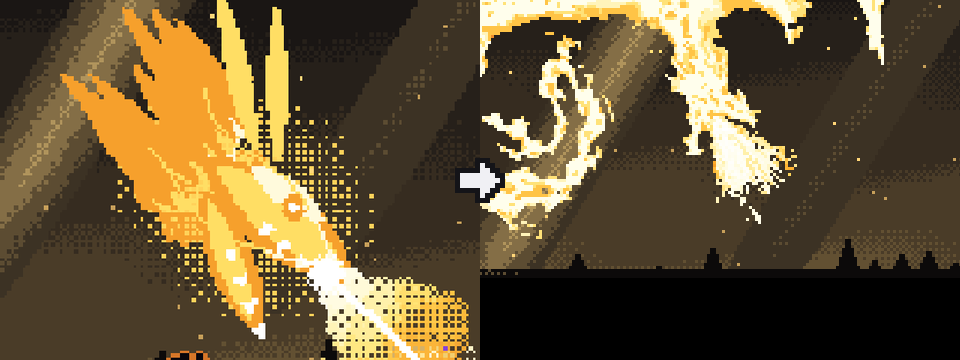

Left: Claude Code drew the dragon from scratch. Right: Claude Code turned a reference image into pixels and moved it.

## Example: Kinryu

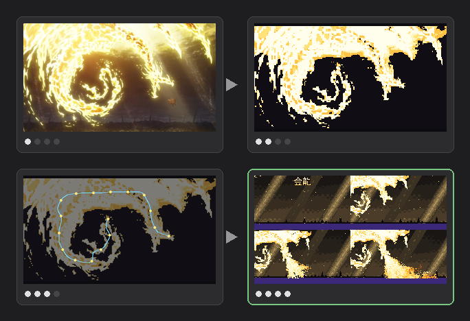

1. Start from one still of a golden dragon.
2. Remove the background and turn it into pixels.
3. Find the spine from head to tail and move the body along it.
4. Put it in the scene: the dragon comes down from the sky, roars and breathes fire.


## Dither

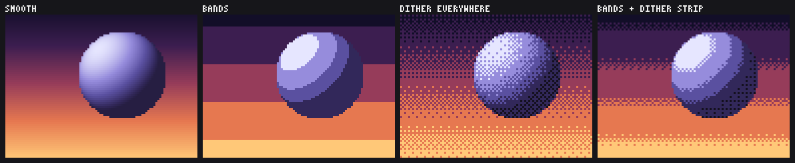

Pixel art has only a few colors. A sky or a round shape still needs to change softly from one color to the next. There are four ways to do it:

- Smooth: every pixel gets its own color. This needs hundreds of colors and looks like a blurry photo, not pixel art.
- Bands: each color is a flat stripe. The edges between the stripes look like lines that are not really there, and the ball looks like a stack of rings.
- Dither everywhere: two colors are mixed in a pattern over the whole area. The change is soft, but everything looks grainy.
- Bands and a dither strip: the colors stay flat, and only a thin strip where two bands meet is mixed. From a little way back, your eye blends the two colors in the strip into one color between them, so the change looks soft and the flat parts stay clean.

Codixel uses the last one. `P.field` and `P.ditherIndex` in the core turn one value per pixel into a palette color this way, and `width` sets how wide the strip is. The pattern is a fixed 4 by 4 grid that stays in the same place in the scene, so it does not flicker in an animation the way random noise does.

## Sound

Don't let the AI make the sounds for your game. AI-made sounds are easy to spot. Have it find sounds on the internet instead.

## Never "do this" or "copy this" and walk away

**Never tell the AI "do this" or "copy this" and leave it. Check it the whole time it works and make sure what you get is what you wanted.**

While this README was being written, the AI added a lot of things I didn't ask for. That is why you should check every step.

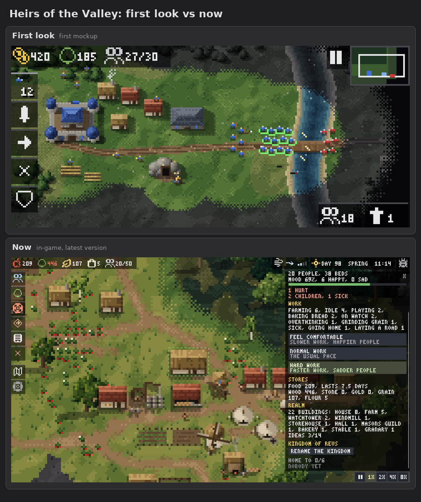

After every step, look at the result:

- Is it the size you wanted?
- Does it look the way you described it?
- Is it the thing you asked for?

If something is wrong, say exactly what is wrong and run the step again. Move on only when the step is right.

## Example: Astral Prison

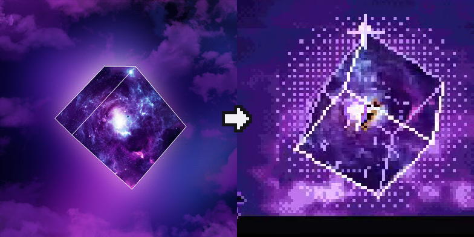

Give the AI a reference to compare with. It understands much better what you want.

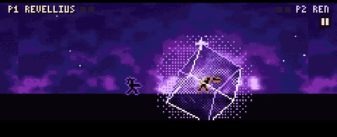

## Example: effects

Made with `core/pixel.js`, which comes with the skill, so the AI does not write effects from scratch. The core also covers the steps from a reference: removing the background, turning it into pixels, bones, bending a long body along its spine, sheets of candidates to pick from, and GIFs.


## Example: mini characters

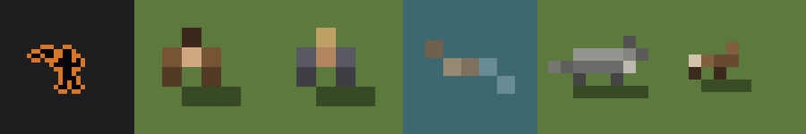

Build characters from only a few pixels so they don't look bad.

## Example: bullet hell

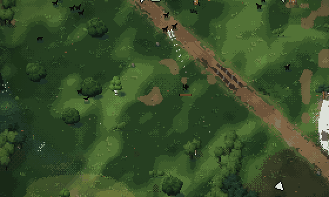

Hollowchain is a survivors-style game. Its enemies are black shapes only 5 by 5 pixels big.

## Example: ocean


Before and after asking for "more realistic".

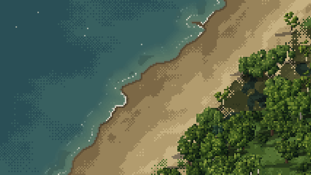

## Example: space backgrounds

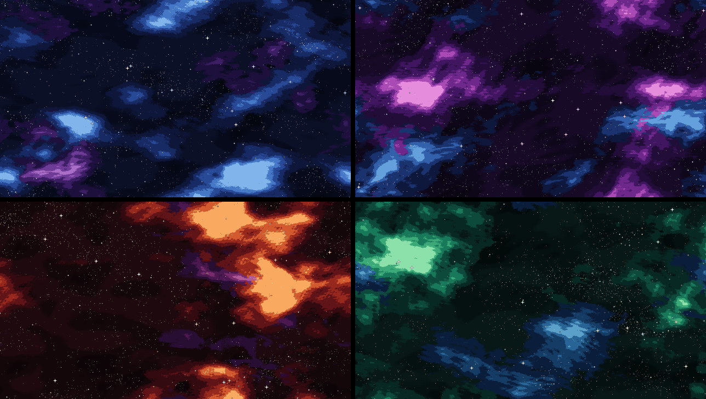

There are four color themes: blue, violet, crimson and emerald. Each one has five layers that tile without a seam: empty space, far stars, nebula, middle stars and near stars.

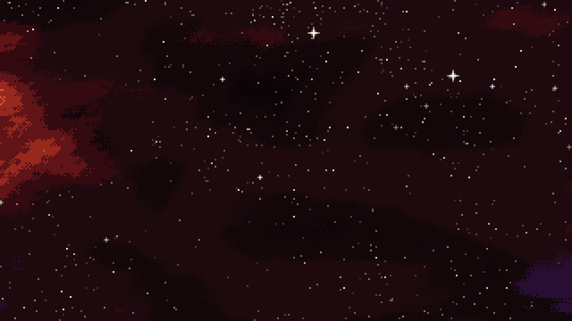

Each layer moves at its own speed, so the near stars go past faster than the far ones.

## Install

```
git clone https://github.com/mankidev/codixel ~/.claude/skills/codixel
```

Claude Code loads it on the next start. It runs when you ask for pixel art.

## License

GPL-3.0-or-later. See [LICENSE](LICENSE).
