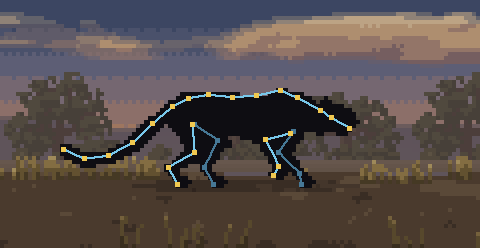
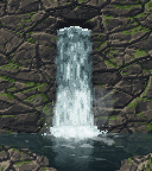
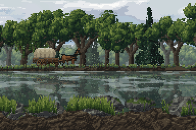
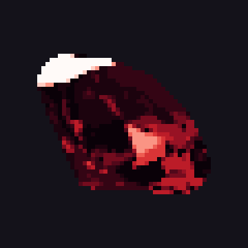

<p align="center"></p>

# Codixel

Codixel is a Claude Code skill for making pixel art with AI: game sprites, characters, animations and effects like fire, smoke and beams. It covers how to describe what you want, the steps from a reference image to a finished animated sprite, and why you have to check every step.


Left: without Codixel. Right: with Codixel.

## Steps


1. Find real images of what you want. Use your own, or ones whose license allows it.
2. Have the AI put it together in code from those images.
3. Ask for bones so the parts can move.
4. Ask for pixel art and say how it should look, for example "realistic".
5. Look at the animation frames one by one.
6. Put it in the scene and check it next to everything else.

Here the bones come before the pixels, because the god is put together from several images. With a single image, like Kinryu, turn it into pixels first and add the bones after.


## What to do

- [Remember Claude Code is not a painter, it only writes code](#claude-code-is-not-a-painter)
- [Start from a real reference image](#example-kinryu)
- [Give a reference to compare with](#examples)
- [Go step by step](#steps)
- [Ask for how it should look, like "realistic"](#examples)
- [Build characters from only a few pixels](#examples)
- [Use dither only where two colors meet](#dither)
- [Find sounds on the internet, don't let the AI make them](#sound)
- [Never say "do this" or "copy this" and walk away, check every step](#never-do-this-or-copy-this-and-walk-away)

## Claude Code is not a painter

**Claude Code cannot draw pixel art from scratch like a painter. It only writes code.**


Left: Claude Code drew the dragon from scratch. Right: Claude Code turned a reference image into pixels and moved it.

## Example: Kinryu


1. Start from one picture of a gold dragon.
2. Take off the background and make it pixels.
3. Find the line from head to tail and move the body along it.
4. Put it in the scene.


## Spines



Codixel is good at understanding animal spines. It builds the body, legs and tail on the spine and moves them the way the real animal walks.

## Dither


Pixel art has only a few colors, so a sky or a ball needs a trick to change softly from one color to the next:

- Smooth: hundreds of colors. It looks like a blurry photo.
- Bands: flat stripes. You see hard lines between them.
- Dither everywhere: soft, but grainy.
- Bands and a dither strip: flat colors, mixed only where two bands meet. Codixel uses this one.

## Sound

Don't let the AI make the sounds for your game. AI-made sounds are easy to spot. Have it find sounds on the internet instead.

## Never "do this" or "copy this" and walk away

**Never tell the AI "do this" or "copy this" and leave it. Check it the whole time it works and make sure what you get is what you wanted.**

While this README was being written, the AI added a lot of things I didn't ask for. That is why you should check every step.


After every step, look at the result. Does it look the way you described it?

If something is wrong, say exactly what is wrong and run the step again. Move on only when the step is right.

## Install

```
git clone https://github.com/mankidev/codixel ~/.claude/skills/codixel
```

Claude Code loads it on the next start. It runs when you ask for pixel art.

## License

MIT. See [LICENSE](LICENSE).

## Examples









