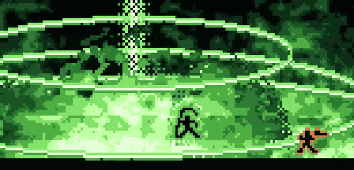
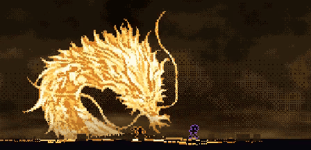

<p align="center"></p>

# pixel-art-with-ai

Claude Code skill for making pixel art with AI. It covers how to describe what you want, the steps from reference to finished sprite, and why you have to check every step.

## What to do

- [Describe it with simple shapes](#ai-is-not-a-painter)
- [Start from a real reference image](#example-kinryu)
- [Go step by step](#steps)
- [Ask for how it should look, like "realistic"](#example-ocean)
- [Build characters from only a few pixels](#example-mini-characters)
- [Never say "do this" or "copy this" and walk away, check every step](#rule-never-do-this-or-copy-this-and-walk-away)

## AI is not a painter

**AI cannot draw pixel art from scratch like a painter. It only writes code, so describe what you want with simple shapes: square, circle, triangle.**


Left: the AI drew the dragon from scratch. Right: the AI turned a reference image into pixels and moved it.

## Example: Kinryu


1. **Reference.** One still of a golden dragon.
2. **Pixelate.** Remove the background and turn it into pixels.
3. **Rig.** Find the spine from head to tail and move the body along it.
4. **Put it in the scene.** The dragon comes down from the sky, roars and breathes fire.


## Steps


1. **Reference.** Find real images of what you want.
2. **Compose.** Have the AI put it together in code from those images.
3. **Rig.** Ask for bones so the parts can move.
4. **Pixelate.** Ask for pixel art and say how it should look, for example "realistic".
5. **Animate.** Look at the frames one by one.
6. **Put it in the scene.** Check it next to everything else.


## Example: effects





## Example: mini characters


Build characters from only a few pixels so they don't look bad.

## Example: bullet hell


## Example: ocean


Before and after asking for "more realistic".

## Rule: never "do this" or "copy this" and walk away

**Never tell the AI "do this" or "copy this" and leave it. Check it the whole time it works and make sure what you get is what you wanted.**


After every step, look at the result:

- Is it the size you wanted?
- Does it look the way you described it?
- Is it the thing you asked for?

If something is wrong, say exactly what is wrong and run the step again. Move on only when the step is right.

## Install

```
git clone https://github.com/mankidev/pixel-art-with-ai ~/.claude/skills/pixel-art-with-ai
```

Claude Code loads it on the next start. It runs when you ask for sprites, icons or tiles.

## License

MIT
