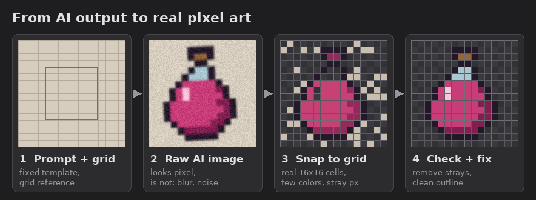

# Pixel art with AI

AI image models draw things that look like pixel art but are not. The pixels are blurry, off-grid and full of in-between colors. The work is turning that into real pixels.

## AI is not a painter

**AI CANNOT DRAW PIXEL ART FROM SCRATCH LIKE A PAINTER. IT ONLY WRITES CODE. SO DESCRIBE WHAT YOU WANT WITH SIMPLE SHAPES: SQUARE, CIRCLE, TRIANGLE.**

A house is a square with a triangle on top. A tree is a circle on a rectangle. Get the shapes right first, then ask for colors, shading and small details.

## Steps

1. **Prompt with a fixed template and a grid.** Keep one prompt template and change only the subject. Give the model a grid reference image so it knows the target size.
2. **Generate big.** Let the model draw at its normal resolution. Expect blur, noise and fake pixels.
3. **Snap to the grid.** Scale down to the real size (16x16, 32x32...) with nearest-neighbor, cut the palette to a few colors, make the background transparent.
4. **Check and fix.** Look at it at 1x and zoomed in. Remove stray pixels, fix the outline, drop anything that does not fit the size.

## Example: Heirs of the Valley

The first mockup next to the latest version of the game. Everything between the two came from small steps, each one checked before the next.

## Rule: never "do this" and walk away

**NEVER TELL THE AI "DO THIS" AND LEAVE IT. CHECK IT THE WHOLE TIME IT WORKS AND MAKE SURE WHAT YOU GET IS WHAT YOU WANTED.**

After every step, look at the result:

- Is it on the grid, at the right size?
- Are the colors the palette you asked for?
- Is it the thing you asked for, in the style you asked for?

If something is wrong, say exactly what is wrong and run the step again. Move on only when the step is right.
