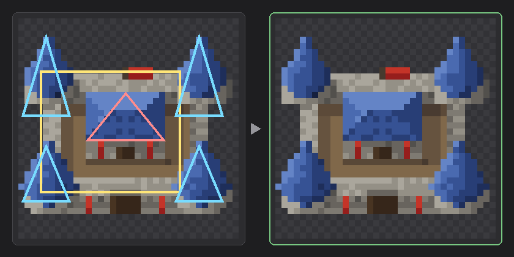
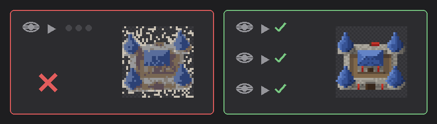

# Pixel art with AI

## AI is not a painter

**AI CANNOT DRAW PIXEL ART FROM SCRATCH LIKE A PAINTER. IT ONLY WRITES CODE. SO DESCRIBE WHAT YOU WANT WITH SIMPLE SHAPES: SQUARE, CIRCLE, TRIANGLE.**

A castle is a square with four cones on the corners and a triangle roof in the middle. Get the shapes right first, then ask for colors, shading and small details.

## Steps

1. **Reference.** Collect a few real images of what you want.
2. **Compose.** Have the AI place the parts in code at full size.
3. **Rig.** Give moving parts simple bones so they can be posed.
4. **Pixelate.** Bring it down to the real size with a few colors per material, flat bands and a narrow dither where two bands meet.
5. **Animate.** Make the frames and look at them one by one.
6. **Put it in the scene.** Check it next to everything else, at the real size.

## Example: Heirs of the Valley

The first version next to the latest version of the game. Everything between the two came from small steps, each one checked before the next.

## Rule: never "do this" and walk away

**NEVER TELL THE AI "DO THIS" AND LEAVE IT. CHECK IT THE WHOLE TIME IT WORKS AND MAKE SURE WHAT YOU GET IS WHAT YOU WANTED.**

After every step, look at the result:

- Is it at the right size, on the pixel grid?
- Are the colors the palette you asked for?
- Is it the thing you asked for, in the style you asked for?

If something is wrong, say exactly what is wrong and run the step again. Move on only when the step is right.
